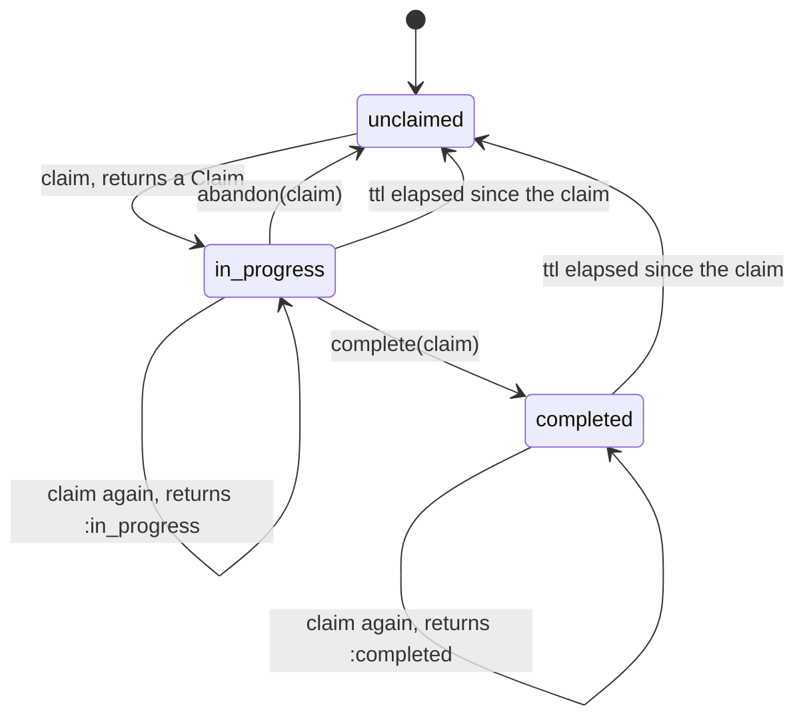
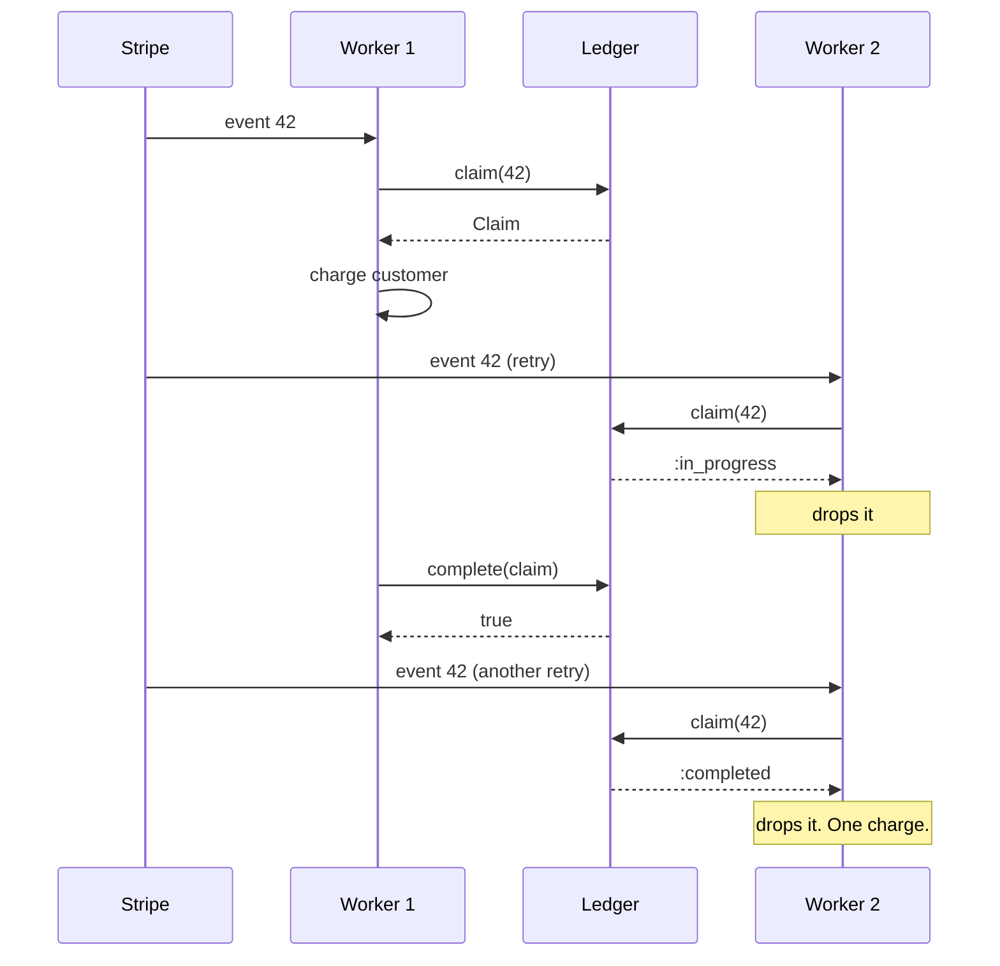

# DedupMachines

> The second copy of a message is not a second order. 📨

A claim ledger for Ruby. Before you act on a message, you claim its key. The ledger tells you whether the key is fresh, already being worked on, or already done. Finish the work and mark it complete. Lose the worker and abandon the claim. Either way, the next copy of the same message gets the right answer instead of a second side effect.

## Quick Start

```bash
gem 'dedup_machines'
```

```ruby
ledger = DedupMachines::Ledger.new

def handle(ledger, event, clock)
  case (claim = ledger.claim(event.id, clock.now_ns, 24 * 3_600_000_000_000))
  when :in_progress, :completed
    return # someone has it, or had it. Nothing to do.
  when :full, :rejected
    raise "ledger refused #{event.id}: #{claim}"
  end

  charge_customer(event)
  ledger.complete(claim, clock.now_ns)
rescue ChargeFailed
  ledger.abandon(claim)
  raise
end
```

One ledger, three methods. Keys and times are Integers. Times are nanoseconds from a clock that only goes forward.

## A Message to the Resistance

So Stripe sent you `payment_intent.succeeded`. Your webhook handler fulfilled the order and sent the confirmation email. Then Stripe, as the docs say it might, sent the same event again. Your handler fulfilled the order and sent the confirmation email.

You know what the docs told you to do. "Make your handler idempotent." Four words, and the entire problem is yours again. So you add a `processed_events` table. Then two workers pick up the same event at the same instant, both find nothing in the table, both proceed. So you add a unique index and a transaction. Then a worker dies after the insert and before the charge, and that event is now marked done forever, and nobody gets charged.

The piece you keep rebuilding is a tiny state machine per key: nobody has it, someone is working on it, someone finished it. With a timeout, so a dead worker's claim doesn't outlive the heat death of the universe. That machine is this gem.

## Chapter 1: Stardate 2025.186, the AMS Birrell

> **AMS Birrell**, NCC-4205, *Birrell*-class courier.
> An echo from the relay is not a second delivery order.

The courier doesn't deliver anything. It keeps the manifest. Every dispatch has an exact identity, and the manifest says whether that identity is unclaimed, out with a crew, or signed for. A relay that bounces the same order back an hour later finds it already signed for and files it under echoes.

On a bridge somewhere, a cadet volunteers:

```ruby
def on_webhook(event)
  return if Redis.current.get("seen:#{event.id}")
  fulfil(event)
  Redis.current.set("seen:#{event.id}", 1)
end
```

"That," says the courier's quartermaster, "is a race with a two-line head start."

## The Flight Plan

Each key the ledger knows about is in one of these states:



And the afternoon Stripe sent event 42 twice, into two workers:



## How the Ledger Works

### Claim

```ruby
ledger = DedupMachines::Ledger.new

claim = ledger.claim(42, 0, 10)   # key 42, now 0 ns, ttl 10 ns
claim.class                        # => DedupMachines::Claim
```

A `Claim` means the key was unclaimed and is now yours. Ask again while you're still holding it and you get a symbol instead:

```ruby
ledger.claim(42, 1, 10)   # => :in_progress
```

### Complete

```ruby
ledger.complete(claim, 2)   # => true
ledger.complete(claim, 2)   # => false, already spent
ledger.claim(42, 9, 10)     # => :completed
```

A completed key keeps answering `:completed` until its ttl runs out. The ttl is measured from the moment of the claim, not from completion.

### Expiry

```ruby
fresh = ledger.claim(42, 10, 10)   # ttl elapsed: a new Claim
ledger.complete(claim, 10)         # => false, the old handle is dead
ledger.abandon(fresh)              # => true
```

Ten nanoseconds after a claim with a ten-nanosecond ttl, the key is unclaimed again. The old `Claim` can't be completed or abandoned any more. Only the new one counts.

### Abandon

A worker that knows it failed gives the key back so the next copy can try:

```ruby
ledger = DedupMachines::Ledger.new
claim = ledger.claim(7, 0, 100)

ledger.abandon(claim)       # => true
ledger.claim(7, 1, 100).class   # => DedupMachines::Claim
```

Abandon only an attempt you know did nothing. If the charge might have gone through, that's a reconciliation problem, not an abandon.

### Capacity

The ledger holds 64 keys at a time. Past that, `claim` says `:full` until something completes and expires, or is abandoned:

```ruby
ledger = DedupMachines::Ledger.new
ledger.capacity                                  # => 64
claims = 64.times.map { |i| ledger.claim(i, 0, 100) }
ledger.claim(65, 0, 100)                         # => :full

ledger.abandon(claims.first)                     # => true
ledger.claim(65, 0, 100).class                   # => DedupMachines::Claim
```

An unexpired key is never evicted to make room. Size your ttl to your traffic, or shard across ledgers.

### Time only moves forward

The ledger remembers the latest `now_ns` it has seen. Hand it an earlier one and it refuses:

```ruby
ledger = DedupMachines::Ledger.new
claim = ledger.claim(1, 10, 10)
ledger.complete(claim, 9)    # => false
ledger.complete(claim, 10)   # => true
ledger.claim(2, 9, 10)       # => :rejected
```

A zero ttl is `:rejected` too. Feed it a monotonic clock in nanoseconds.

## The Rules of the Courier

- **Keys and times are Integers** in `0..2**64-1`. Times are nanoseconds. Floats, nil, and strings raise `TypeError`. Out of range raises `RangeError`.
- **Claims belong to one ledger.** A `Claim` from one `Ledger` is refused by another, with `false`, even for the same key. Claims can't be built or copied by hand.
- **Refusals don't raise.** `:in_progress`, `:completed`, `:full`, `:rejected`, and `false` are answers. Only malformed input raises.
- **Frozen means frozen.** `freeze` the ledger and `claim`, `complete`, and `abandon` all raise `FrozenError`.

## What You Think You're Doing vs Reality

### You Think: "I'll check if I've seen it, then process it."
### Reality: Two workers both haven't seen it.

The check and the processing are two steps, and a second copy of the message fits neatly between them. The only check that works is one that *takes* the key as it reads it. `claim` is that check. There's no window, because there's no second step.

## What's Yours

The ledger lives in your process and forgets everything when the process does. If duplicates can arrive after a restart, write completed keys somewhere durable and seed a fresh ledger's decisions from that. A claim that times out may belong to a worker that's still running. Fence or reconcile its side effects before letting the next copy through.

## License

MIT License. See [LICENSE.txt](LICENSE.txt) for details.

**Remember: Stripe will send it twice. The question is whether you charge twice.**
