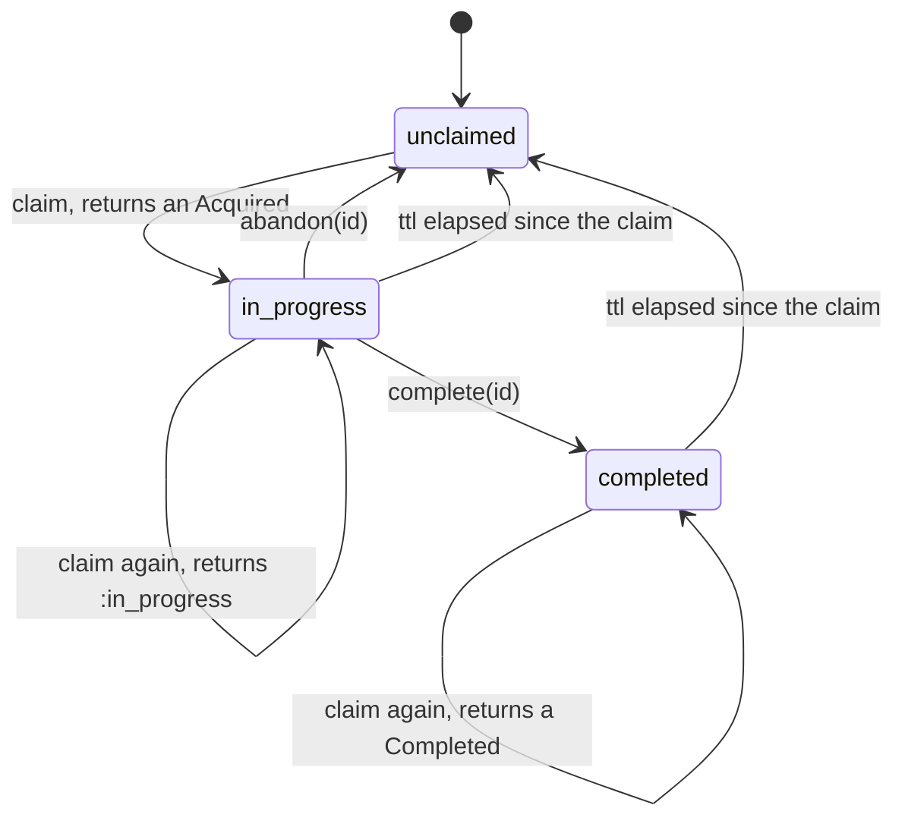

# DedupMachines

> The second copy of a message is not a second order. 📨

A claim ledger for Ruby. Before you act on a message, you claim its key. The ledger tells you whether the key is fresh, already being worked on, or already done. Finish the work and mark it complete. Lose the worker and abandon the claim. Either way, the next copy of the same message gets the right answer instead of a second side effect.

## Quick Start

```bash
gem 'dedup_machines'
```

```ruby
ledger = DedupMachines::Ledger.new

def handle(ledger, event, clock)
  case ledger.claim(event.id, clock.now_ns, 24 * 3_600_000_000_000)
  in DedupMachines::Acquired[id]
    charge_customer(event)
    ledger.complete(id, clock.now_ns)
  in :in_progress | DedupMachines::Completed
    nil # someone has it, or had it. Nothing to do.
  in Symbol => refusal
    raise "ledger refused #{event.id}: #{refusal}"
  end
rescue ChargeFailed
  ledger.abandon(id)
  raise
end
```

One ledger, a handful of methods. Keys, values and times are Integers. Times are nanoseconds from a clock that only goes forward.

## A Message to the Resistance

So Stripe sent you `payment_intent.succeeded`. Your webhook handler fulfilled the order and sent the confirmation email. Then Stripe, as the docs say it might, sent the same event again. Your handler fulfilled the order and sent the confirmation email.

You know what the docs told you to do. "Make your handler idempotent." Four words, and the entire problem is yours again. So you add a `processed_events` table. Then two workers pick up the same event at the same instant, both find nothing in the table, both proceed. So you add a unique index and a transaction. Then a worker dies after the insert and before the charge, and that event is now marked done forever, and nobody gets charged.

The piece you keep rebuilding is a tiny state machine per key: nobody has it, someone is working on it, someone finished it. With a timeout, so a dead worker's claim doesn't outlive the heat death of the universe. That machine is this gem.

## Chapter 1: Stardate 2025.186, the AMS Birrell

> **AMS Birrell**, NCC-4205, *Birrell*-class courier.
> An echo from the relay is not a second delivery order.

The courier doesn't deliver anything. It keeps the manifest. Every dispatch has an exact identity, and the manifest says whether that identity is unclaimed, out with a crew, or signed for. A relay that bounces the same order back an hour later finds it already signed for and files it under echoes.

On a bridge somewhere, a cadet volunteers:

```ruby
def on_webhook(event)
  return if Redis.current.get("seen:#{event.id}")
  fulfil(event)
  Redis.current.set("seen:#{event.id}", 1)
end
```

"That," says the courier's quartermaster, "is a race with a two-line head start."

## The Flight Plan

Each key the ledger knows about is in one of these states:



And the afternoon Stripe sent event 42 twice, into two workers:


## How the Ledger Works

### Claim

```ruby
ledger = DedupMachines::Ledger.new

claim = ledger.claim(42, 0, 10)   # key 42, now 0 ns, ttl 10 ns
claim                              # => #<data DedupMachines::Acquired id=#<data DedupMachines::ClaimId raw=1>>
id = claim.id
```

An `Acquired` means the key was unclaimed and is now yours. Its `id` is what you complete or abandon later. Ask again while you're still holding it and you get a symbol instead:

```ruby
ledger.claim(42, 1, 10)   # => :in_progress
```

Both are answers, not refusals. You asked "may I run this?" and the ledger told you the truth.

### Complete

```ruby
ledger.complete(id, 2)      # => :completed
ledger.complete(id, 2)      # => :already_completed, same claim, nothing changed
ledger.claim(42, 9, 10)     # => #<data DedupMachines::Completed value=0>
```

A completed key keeps answering `Completed` until its ttl runs out. The ttl is measured from the moment of the claim, not from completion.

### Complete with a value

```ruby
ledger = DedupMachines::Ledger.new
id = ledger.claim(7, 0, 100).id

ledger.complete_with(id, 4242, 1)   # => :completed
ledger.claim(7, 2, 100).value       # => 4242, the duplicate gets the first result
ledger.complete_with(id, 4242, 3)   # => :already_completed
ledger.complete_with(id, 9999, 3)   # => :mismatch, the recorded 4242 stands
```

The value is an Integer: an order number, a row id, the index of the response you stored elsewhere. `complete(id, now)` is `complete_with(id, 0, now)`.

### Expiry

```ruby
ledger = DedupMachines::Ledger.new
id = ledger.claim(42, 0, 10).id

fresh = ledger.claim(42, 10, 10).id   # ttl elapsed: a new claim
ledger.complete(id, 10)               # => :stale, the old id is dead
ledger.abandon(fresh)                 # => :abandoned
```

Ten nanoseconds after a claim with a ten-nanosecond ttl, the key is unclaimed again. The old id can't be completed or abandoned any more. Only the new one counts.

An expired record isn't swept on a timer. It simply stops counting: every call reads it as gone. The next claim that is actually acquired clears the expired ones out and reuses their room.

"Expired" is a statement about the `now` you passed, not a verdict the ledger keeps. A refusal records nothing, the clock included, so a completion refused as `:stale` at one instant is honoured at an earlier one, as long as that instant isn't behind the latest *honoured* call:

```ruby
ledger = DedupMachines::Ledger.new
id = ledger.claim(42, 0, 10).id

ledger.complete(id, 10)   # => :stale, expired at 10, and nothing recorded
ledger.complete(id, 5)    # => :completed, 5 is not behind the last honoured call (0)
```

What ends the old id for good is an honoured call, as in the first example: the fresh claim at 10 was recorded, it replaced the record, and from then on the old id is `:stale` or `:time_regression` whatever `now` you bring. Don't treat a `:stale` you got for lateness as proof that nobody can complete that claim. `abandon` takes no clock at all and reads the recorded one, so it also still frees a claim that was only ever refused as expired.

### Abandon

A worker that knows it failed gives the key back so the next copy can try:

```ruby
ledger = DedupMachines::Ledger.new
id = ledger.claim(7, 0, 100).id

ledger.abandon(id)          # => :abandoned
ledger.abandon(id)          # => :stale, it's gone and the ledger keeps no history
ledger.claim(7, 1, 100)     # => an Acquired again
```

Abandon only an attempt you know did nothing. If the charge might have gone through, that's a reconciliation problem, not an abandon. A completed claim can't be abandoned: that's `:concluded`.

### Fingerprints

The same key with a different payload is not a duplicate. It's a bug upstream, and replaying the first answer would hide it:

```ruby
ledger = DedupMachines::Ledger.new
ledger.claim_with(7, 0xA11CE, 0, 100)   # => an Acquired, key 7 under this fingerprint
ledger.claim_with(7, 0xA11CE, 1, 100)   # => :in_progress
ledger.claim_with(7, 0xB0B, 1, 100)     # => :conflict
ledger.claim(7, 1, 100)                 # => :conflict, no fingerprint is a different one
```

### Partitions

Give each tenant, session or source a quota so one of them can't fill the table:

```ruby
ledger = DedupMachines::Ledger.new.with_partition_cap(2)
attempt = DedupMachines::Attempt.new(1, nil, 9)   # key, fingerprint, partition

ledger.admit(attempt, 0, 100)                                   # => an Acquired
ledger.admit(DedupMachines::Attempt.new(2, nil, 9), 0, 100)     # => an Acquired
ledger.admit(DedupMachines::Attempt.new(3, nil, 9), 0, 100)     # => :partition_full
ledger.admit(DedupMachines::Attempt.new(3, nil, 8), 0, 100)     # => an Acquired
```

`with_partition_cap` returns a capped copy and leaves the receiver alone. An attempt with a `nil` partition isn't counted. A cap past the platform's `usize` (only possible on a 32-bit host) raises `RangeError` rather than being rounded to one you didn't ask for.

### Dropping the ownerless

When a tenant leaves, its records don't have to wait out their ttl:

```ruby
ledger.expire_where { |key| key < 3 }   # => how many live records it dropped
```

The block is asked about every live key before anything is dropped, so a block that raises drops nothing. Only records the block was shown are dropped: if the block abandons a key and claims it again, the new claim stays.

### Capacity

The ledger holds 64 keys at a time. Past that, `claim` says `:full` until something expires or is abandoned:

```ruby
ledger = DedupMachines::Ledger.new
ledger.capacity                                  # => 64
ids = 64.times.map { |i| ledger.claim(i, 0, 100).id }
ledger.claim(65, 0, 100)                         # => :full

ledger.abandon(ids.first)                        # => :abandoned
ledger.claim(65, 0, 100)                         # => an Acquired
```

A live key is never evicted to make room. Size your ttl to your traffic, or shard across ledgers.

### Time only moves forward

The ledger remembers the latest `now` an honoured call showed it. Hand it an earlier one and it refuses:

```ruby
ledger = DedupMachines::Ledger.new
id = ledger.claim(1, 10, 10).id
ledger.complete(id, 9)       # => :time_regression
ledger.complete(id, 10)      # => :completed
ledger.claim(2, 9, 10)       # => :time_regression
ledger.claim(2, 10, 0)       # => :invalid_duration
```

Feed it a monotonic clock in nanoseconds: `Process.clock_gettime(Process::CLOCK_MONOTONIC, :nanosecond)`.

### Scopes and restarts

A claim id is an Integer underneath, so it survives a queue or a database column:

```ruby
ledger = DedupMachines::Ledger.with_scope(7)
id = ledger.claim(1, 0, 100).id
id.raw                                 # => 1970324836974593, scope 7 above sequence 1
id.scope                               # => 7
ledger.complete(DedupMachines::ClaimId.new(id.raw), 1)   # => :completed
```

Two ledgers in the same scope issue the same integers. Give each ledger whose ids could meet its own scope, and an id from the wrong ledger is `:stale` instead of settling somebody else's claim.

A restart must not rewind the sequence, or an id that outlived it would name a new claim. Save four things and hand them back:

```ruby
saved = [ledger.entries, ledger.scope, ledger.issued, ledger.observed]
ledger = DedupMachines::Ledger.resumed(*saved)   # => a Ledger, or RangeError
```

`resumed` raises `RangeError` when the saved state isn't that scope's: an entry whose claim id carries another scope or a sequence past `issued`, or two entries under one key or one id, the same entry listed twice included. A constructor has no refusal symbol to answer with, and saved state that doesn't add up is malformed input, so it raises like every other restoring constructor in the fleet; it never answers `nil`. If you can't save the count, start each incarnation in a scope no earlier one used.

## Every answer

Honoured answers say what happened. Refusals are symbols, one per reason, and a refused call changed nothing: not a record, not the clock, not an id.

| Call | Honoured | Records `now` | Refusals |
| --- | --- | --- | --- |
| `claim(key, now, ttl)` | `Acquired`, `:in_progress`, `Completed` | every honoured answer: each depends on what expired by `now` | `:time_regression`, `:invalid_duration`, `:overflow`, `:conflict`, `:exhausted`, `:full` |
| `claim_with(key, fingerprint, now, ttl)` | as `claim` | as `claim` | as `claim` |
| `admit(attempt, now, ttl)` | as `claim` | as `claim` | as `claim`, plus `:partition_full` |
| `complete(id, now)` | `:completed`, `:already_completed` | `:completed` only; a repeat holds whatever the time | `:stale`, `:time_regression`, `:mismatch` |
| `complete_with(id, value, now)` | `:completed`, `:already_completed` | as `complete` | `:stale`, `:time_regression`, `:mismatch` |
| `abandon(id)` | `:abandoned` | takes no clock; judges liveness at `observed` | `:stale`, `:concluded` |
| `expire_where { \|key\| ... }` | an Integer count; a drain never refuses | takes no clock; judges liveness at `observed` | |
| `Ledger.resumed(entries, scope, issued, observed)` | a `Ledger` | | none: raises `RangeError` for saved state that isn't that scope's |

What each refusal means:

| Symbol | Meaning |
| --- | --- |
| `:time_regression` | `now` is earlier than the latest instant the ledger observed |
| `:invalid_duration` | the ttl is zero |
| `:overflow` | `now + ttl` doesn't fit; unreachable from Integer nanoseconds below 2**64 |
| `:exhausted` | the ledger has issued all 2**48 - 1 claim ids of its scope |
| `:conflict` | the key is live under a different fingerprint |
| `:full` | all 64 slots hold a live record |
| `:partition_full` | the attempt's partition holds its quota of live records |
| `:stale` | the id names no live claim here at the `now` supplied: expired by then, abandoned, dropped, another scope, never issued |
| `:concluded` | the claim is completed and can't be abandoned |
| `:mismatch` | the claim is already completed with a different value |

## The Rules of the Courier

- **Keys, fingerprints, partitions and values are Integers** in `0..2**64-1`. Instants and ttls are Integer nanoseconds in the same range. Floats, nil, and strings raise `TypeError`. Out of range raises `RangeError`.
- **Answers are not refusals.** `:in_progress` and `Completed` are the ledger doing its job for a duplicate. They record `now` and change nothing else. An `Acquired` records `now`, clears out expired records and stores yours.
- **Refusals don't raise, and change nothing.** Only malformed input raises.
- **A refusal about time is about the instant you gave.** `:stale` for an expired claim and `:time_regression` record nothing; the same call at another instant may be honoured. Only honoured calls move the clock.
- **Repeats are honoured when they can be proved.** Completing a completed claim with the same value is `:already_completed`. With another value it's `:mismatch`. A second `abandon` is `:stale`, because nothing is left to prove it by.
- **Ids are never reissued.** Not when a slot is reused, not when the key is claimed again. An id from another scope is `:stale` before the ledger looks anything up.
- **Values are valid or don't exist.** `ClaimId`, `Acquired`, `Completed`, `Attempt` and `Entry` check themselves when built, by hand or by the ledger: `TypeError` for the wrong type, `RangeError` for a value the core rejects. `ClaimId.new(0)` raises `RangeError`: no ledger issues a sequence of zero. They are final: subclassing one raises `TypeError` and `allocate` is gone. That stops accidents, not reflection (a named subclass still leaves its constant behind; `Marshal.load` and a hand-bound `Data#initialize` skip the check), so the extension is the authority: every `ClaimId`, `Attempt` or `Entry` it reads must be exactly its class (`TypeError` otherwise, a subclass included), and its fields are read natively and checked again (`RangeError`). A forged value never reaches the ledger and never earns a refusal symbol.
- **Nothing is lost to an exception.** Every argument is checked before the ledger is asked, and the value classes are resolved once, when the extension loads. Building an answer runs Ruby code (`new`, which a reopened class can redefine), so `claim`, `claim_with` and `admit` decide on a copy, build the answer, and keep the copy only if the ledger is still unfrozen and unchanged: a `new` that raises applies nothing (no claim is taken whose id you never saw), one that freezes the ledger raises `FrozenError`, one that calls back in and changes it raises `RuntimeError`, and the outer call is not applied. No call holds the ledger borrowed while Ruby code runs, so calling back in is never fatal.
- **Frozen means frozen.** `freeze` the ledger and `claim`, `claim_with`, `admit`, `complete`, `complete_with`, `abandon`, and `expire_where` all raise `FrozenError`.

## What You Think You're Doing vs Reality

### You Think: "I'll check if I've seen it, then process it."
### Reality: Two workers both haven't seen it.

The check and the processing are two steps, and a second copy of the message fits neatly between them. The only check that works is one that *takes* the key as it reads it. `claim` is that check. There's no window, because there's no second step.

## What's Yours

The ledger lives in your process and forgets everything when the process does. If duplicates can arrive after a restart, write `entries`, `scope`, `issued` and `observed` somewhere durable and bring them back with `Ledger.resumed`. A claim that times out may belong to a worker that's still running. Fence or reconcile its side effects before letting the next copy through.

## License

MIT License. See [LICENSE.txt](LICENSE.txt) for details.

**Remember: Stripe will send it twice. The question is whether you charge twice.**
